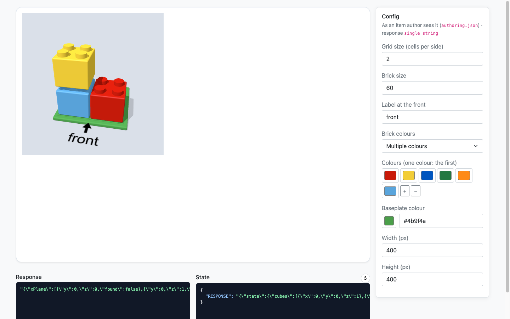
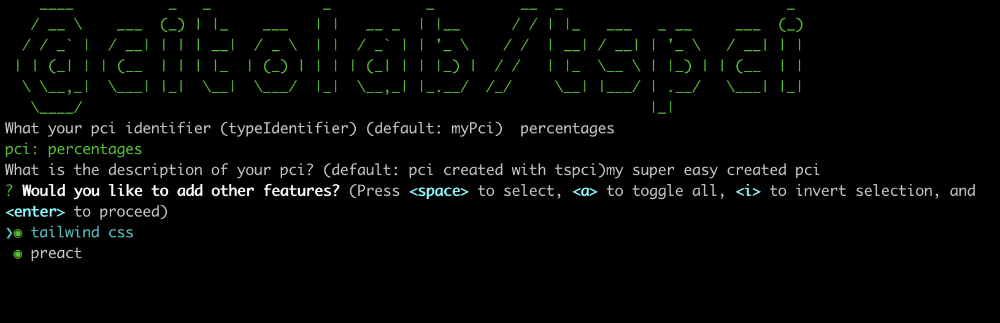

<h1>
	A modern QTI-PCI development environment creating and testing portable custom interactions
</h1>

<p align="center">
  
</p>

[Release notes](https://github.com/Citolab/tspci/blob/main/lib/tspci/release-notes.md)

## ✨ Features <a name="features"></a>

- Use modern tooling like typescript, preact, postcss and tailwind
- Build and bundle your library PCI using only a `package.json`
- Test and develop all your PCI states, configs, responses and lifecycle without uploading
- Develop in live server which directly updates on code changes
- Produces a single bundle .js file to use in any delivery engine that supports the latest IMS PCI standard
- 0 configuration TypeScript support
- Bundles all your css, images and json files.
- Postcss support, use CSS nesting out of the box.
- First class (p)react and tailwind support
- Extension for TAO, configuring icon, label, support for setting correct response and pci-properties
- Generates a CycloneDX SBOM of the components that are actually in your bundle
- Tells authoring systems how to configure and score your PCI (`authoring.json`, see [Authoring systems](#authoring-systems))

## 🔧 Installation & Setup

### Cli

The easiest way to setup a pci develop environment is by using the cli.
This will ask a few options, and creates a PCI development environment with an example implementation.

<p align="center">
  
</p>

Run: `npx @citolab/tspci@latest init`

1. It will ask to download the latest version of tspci.
2. If agreed; tspci will be downloaded and started.
3. You should provide a name/identifier for your PCI.
4. You should provide a description.
5. Last option is to choose how you want to build your pci, using tailwind and preact, typescript or javascript

Every choice gives the same working demo, each in its own idiom: "what percentage of the circle is coloured?". The
circle is an SVG drawn from the settings in `src/config.json` (`title`, `question`, `segments`, `colored`, `color`,
`size`, each with an editor and an English and Dutch label for authoring systems), and the candidate types a whole
number. It shows what every PCI needs:

- `getResponse()` reports `{ base: { integer: 30 } }`, or `undefined` while nothing is answered, matching
  `config.tspci.response` in `package.json`;
- `getState()` and the `state` argument, `setResponse()` and `boundTo` restore an answer;
- `status: "review"`/`"solution"` make it read-only, and with `"solution"` it shows
  `responseDeclaration.correctResponse`;
- a labelled input with a focus ring, `aria-invalid` for an answer outside 0-100, and a layout that scales down.

| choice | files in `src` | styling |
| --- | --- | --- |
| `typescript` | `index.ts` (the PCI), `pie.ts` (the SVG) | `styles.css`, plain CSS in the shadow root |
| `javascript` | `index.js`, `pie.js` | `styles.css` |
| `preact+tailwind` | `index.tsx` (the PCI), `interaction.tsx` and `pie.tsx` (components), `store.ts` | Tailwind classes in the components, `styles.css` loads Tailwind |

#### Tailwind

Tailwind is a popular css framework and can be used to give a nice look and feel of the PCI. The cli will make sure the css is added; and all build stuff that comes with tailwind is setup. The components use Tailwind classes directly; the build compiles Tailwind 4 into the bundle and adds it to the shadow root of the PCI, including the defaults its borders, rings and shadows need there.

#### preact

preact is a small version of react. You can develop your PCI using hooks and the render function as you are familiar with in react. When preact is selected the cli will also add a store to manage state. This can easily be used to store all user actions in the PCI, and even replay them.

One trap with SVG: Preact writes attributes on SVG elements exactly as you spell them, and SVG attribute names are case-sensitive. `tabIndex` on an SVG element does nothing, so a keyboard user can never reach it; write `tabindex` (on HTML elements both work).

### specific implementations like TAO.

We also support to create a PCI that can be imported in TAO. Therefor you should use @citolab/tspci-tao.

To add tao using the cli you should run the following command inside your PCI folder:

```sh
  npm run tspci -- add --target tao
```

For more info: [@citolab/tspci-tao](https://github.com/Citolab/tspci/tree/main/lib/tspci-tao)

### QTI 3 package export

You can also export a QTI 3 package zip containing:
- one assessment item with identifier `ITM-PCI`
- one assessment test with a single testPart, section, and that item
- a QTI 3 manifest

To add QTI 3 support using the cli run:

```sh
  npm run tspci -- add --target qti3
```

Then build the package:

```sh
  tspci --target qti3
```

For more info: [@citolab/tspci-qti3](https://github.com/Citolab/tspci/tree/main/lib/tspci-qti3)

### Authoring systems

An item author places your PCI in an item in an authoring system (qti-construction, TAO), sets it up and decides what
counts as a correct answer. tspci tells the authoring system how, in `authoring.json`, the descriptor of the
[PCI Authoring Profile 1.0](../../docs/spec/README.md) (an optional profile on top of QTI 3 PCIs; coming from tspci 2,
see [MIGRATION.md](../../docs/spec/MIGRATION.md)). It is a build output, written to
`dist/` by every build and packaged next to the bundle (`resources/pci/authoring.json` in a qti3 package, a file of
the PCI resource in the manifest, like the SBOM). You write nothing extra; it is generated from two files you already
have:

- **`src/config.json`, the settings.** A value is a plain default (as always), or an object with a `default` and
  hints for the author's form: `editor` (`text`, `textarea`, `integer`, `number`, `boolean`, `enum` with `options`,
  `color`, `colorList`, `hidden`), `label` (one string or one per language), `min`/`max`. The bundle gets only the
  defaults, so `import configProps from "./config.json"` keeps working; type it as `PciProperties<typeof configProps>`.
- **`package.json` `config.tspci`, the response.** `response` is the variable `getResponse()` fills
  (`{ "cardinality": "single", "baseType": "integer" }`, or a `record` with typed `fields` for a PCI that reports
  several values), `scoring` how it may be scored (`match_correct`, `human`, or `none` for a tool), `markup` the
  elements an author puts in the interaction markup (a video, an image).

```jsonc
// dist/authoring.json (generated)
{
  "descriptorVersion": "1.0",
  "typeIdentifier": "blocks",
  "version": "1.0.0",
  "label": "3d blocks",
  "properties": {
    "brickColorMode": { "editor": "enum", "default": "mixed", "options": [{ "value": "mixed" }, { "value": "single" }] },
    "baseplateColor": { "editor": "color", "default": "#4b9f4a" }
  },
  "markup": {},
  "response": { "cardinality": "single", "baseType": "string" },
  "scoring": ["match_correct", "human"]
}
```

The qti3 export declares the item's response from `config.tspci.response` (it used to be `single`/`string` always),
and the build warns about what an authoring system could not use: an unknown editor, an enum default that is not one
of its options, a record field without a base type, a margin on a type it cannot measure, a correct response on a tool.
It stops on the keys tspci 3 renamed (`score`, `role`, `correctResponse: "settings"`), with what to write instead.

**Scoring.** Authors set the correct answer by answering your PCI in a preview: what `getResponse()` reports becomes
the correct response, or one of several accepted answers, and scoring compares responses. So report the meaning,
not the route (the same answer must give the same response), report the declared type, return `undefined` without an
answer, and show a given response (`setResponse`, `boundTo`, and `responseDeclaration.correctResponse` in
`status: "solution"`). Margins (a time window, an area) live in the item's response processing, which the authoring
system writes; `tolerance` (`range` for numbers, `area` for points) on the response or a record field says which kind
fits.

**The correct response from the settings.** When the correct answer follows from the settings (3 of 10 slices → 30),
the registered object gets `getCorrectResponse(properties)` next to `getInstance`, and `config.tspci.correctResponse`
is `"properties"`. An authoring system fills the item's correct response with it and keeps it in line when the author
changes a setting. Every setting that changes the correct answer must be visible to the student, or the question
cannot be answered. Players never call it; the templates `tspci init` makes have one.

**Tools.** A PCI that helps the student but is never scored (a ruler, a calculator) has `config.tspci.scoring:
["none"]`. It still has a response variable, as QTI requires, but no correct response.

**Markup slots.** The authoring system marks the element it puts in a slot with its name,
`<video data-pci-slot="video" src>`; `slot("video", dom)` from `@citolab/tspci/media` finds it.

**Authoring mode.** A setting with `"editor": "pci"` is edited by the PCI itself: next to `getInstance`, the registered
object has `getAuthoringInstance(dom, config)`, which returns `{ getProperties, validate?, oncompleted? }`. An authoring
system shows a "Configure…" button and runs it in a sandboxed iframe with a small host page
(`src/authoring-frame.js`). Delivery never calls it and sees ordinary `data-` attributes. The proposal is in
[`docs/authoring-mode.md`](../../docs/authoring-mode.md).

Every project made with `tspci init` has an `AUTHORING.md` that explains all of this with examples and a checklist.

### SBOM

Every production build (`tspci`, `tspci --target ...`) writes a [CycloneDX](https://cyclonedx.org/) 1.6
SBOM to `dist/sbom.cdx.json`. A package export puts it in two places: inside the package next to the
bundle it describes, and next to the package as `<package-name>.sbom.cdx.json` so you keep one SBOM per
released version for your own technical documentation.

The SBOM is built from the rollup module graph, so it lists the packages whose code actually ended up
in the bundle. That is different from what `npm sbom`, `cyclonedx-npm` or Syft produce for a PCI: those
read the dependency tree and would list build-time packages (rollup, typescript, tailwind, terser) that
are never delivered, while missing dependencies that got inlined into the bundle.

It also records a SHA-512 hash of the built bundle. A customer who integrates your PCI is the
manufacturer of the complete product and has to do due diligence on integrated third party components;
the hash lets them verify that the SBOM belongs to the bundle they received.

The SBOM ships inside the package because a file next to the zip does not survive an import into an
authoring system, and that system is exactly the party that needs it: it is the manufacturer of the
complete product and has to document the components it integrates. The Cyber Resilience Act does not
require in band delivery, so `--no-include-sbom` (or `config.tspci.sbom.includeInPackage: false`) keeps
it out of the package while still writing it to `dist` and next to the package:

```sh
  tspci --target qti3 --no-include-sbom
```

Where it lands inside the package differs per target, always next to the bundle:

| target | in the package |
| --- | --- |
| qti3 | `resources/pci/sbom.cdx.json`, listed as a file of the PCI resource in the manifest |
| tao | `interaction/runtime/js/sbom.cdx.json` |
| qbci | `ref/script/sbom.cdx.json` |

For qti3 it is a `<file>` of the existing PCI resource rather than a resource of its own. QTI has no
resource type for a bill of materials, and an unreferenced resource is what manifest driven tooling
drops first.

Generating the SBOM needs no flag either, it happens on every production build. Use `--no-sbom` to skip
it for a single build, or `config.tspci.sbom.enabled: false` to switch it off for a project:

```sh
  tspci --target qti3 --no-sbom
```

#### Known limitations

The SBOM can only describe what passes through the bundler. It does not cover:

- code loaded at runtime from a CDN (MathJax, MathLive, chart libraries)
- third party code that was copied into your own `src` folder
- the delivery engine itself (`qtiCustomInteractionContext` is external on purpose)

The build warns about the first two when it can detect them (a script url in the bundle or in
`src/index.html`, a path that looks like `src/vendor/...` or a `*.min.js` file). Declare those
components manually so they end up in the SBOM.

#### Configuration

All settings are optional and live in `config.tspci.sbom` in your `package.json`:

```json
{
  "config": {
    "tspci": {
      "typeIdentifier": "myPci",
      "sbom": {
        "supplier": { "name": "Cito", "url": "https://www.cito.nl" },
        "supportPeriodEnd": "2032-12-31",
        "externalReferences": [
          { "type": "vulnerability-disclosure", "url": "https://www.cito.nl/security" },
          { "type": "security-contact", "url": "mailto:security@example.org" }
        ],
        "additionalComponents": [
          {
            "name": "mathjax",
            "version": "3.2.2",
            "license": "Apache-2.0",
            "purl": "pkg:npm/mathjax@3.2.2",
            "externalReferences": [
              { "type": "distribution", "url": "https://cdn.jsdelivr.net/npm/mathjax@3.2.2/es5/tex-mml-chtml.js" }
            ]
          }
        ]
      }
    }
  }
}
```

| Option | Default | Description |
| --- | --- | --- |
| `enabled` | `true` | Set to `false` to skip SBOM generation |
| `fileName` | `sbom.cdx.json` | Name of the generated file |
| `supplier` | `author` from `package.json` | Supplier of the PCI, as name or `{ name, url, contact }` |
| `supportPeriodEnd` | - | Recorded as a property on the PCI component |
| `externalReferences` | - | CycloneDX external references for the PCI, e.g. your disclosure policy |
| `additionalComponents` | `[]` | Components the bundler cannot see, e.g. CDN or vendored code |
| `includeInPackage` | `true` | Set to `false` to keep the SBOM out of the exported package |
| `properties` | `[]` | Extra CycloneDX properties on the PCI component |
| `warnings` | `true` | Set to `false` to silence the warnings about gaps |
| `timestamp` | `false` | Include a build timestamp. Off by default so a rebuild of the same sources gives an identical document |

Declaring a component in `additionalComponents` also silences the warning about the matching runtime
url. Set `TSPCI_SBOM_TIMESTAMP=1` to add a timestamp for a single build.

### Manual

1️. **Install** by running: `npm i -D @citolab/tspci`

2️. **Set up** your `package.json`:

`// package.json`

```json
{
  "name": "@citolab/hello-world",
  "description": "Hello world pci",
  "version": "1.0.0",
  "main": "dist/index.js",
  "types": "dist/types.d.ts",
  "dependencies": {},
  "devDependencies": {
    "@citolab/tspci": "^1.5.6",
    "@citolab/tspci-tao": "^1.0.0",
    "@citolab/tspci-qti3": "^1.0.0"
  },
  "config": {
    "tspci": {
      "typeIdentifier": "helloWorld"
    }
  },
  "scripts": {
    "dev": "tspci --dev",
    "prod": "tspci"
  },
  "source": "src/index.ts"
}
```

Add the following PCI in the src folder `index.ts`

```ts
// src/index.ts
	import { ConfigProperties, IMSpci, IMSpciFactory } from "@citolab/tspci";
	import * as ctx from "qtiCustomInteractionContext";

	class PciInstance implements IMSpci<{}> {
	  typeIdentifier = "HelloWorld"; // same as in package.json
	  private shadowdom: ShadowRoot;

	  constructor(dom: HTMLElement, config: ConfigProperties<{}>, state?: string) {
	    this.shadowdom = dom.attachShadow({ mode: "closed" });
	    this.render();
	    config.onready(this, this.getState());
	  }

	  private render = () => {
	    this.shadowdom.innerHTML = `<div>Hello-World</div>`;
	  };

	  getResponse = () => undefined;
	  getState = () => JSON.stringify({ v: 1 });
	}

	const factory: IMSpciFactory<{}> = {
	  typeIdentifier: "HelloWorld",
	  getInstance: (dom, config, state) => new PciInstance(dom, config, state),
	};

	ctx && ctx.register(factory);
	export default factory;
```

Add this in your root project: `global.d.ts` file

```ts
// global.d.ts
declare module "qtiCustomInteractionContext" {
  const register: { register: (factory: { typeIdentifier: string; getInstance: Function }) => void };
  export = register;
}
```

Add a `tsconfig.json` to your project for type checking

```json
{
  "compilerOptions": {
    "declaration": true,
    "lib": ["es6", "dom", "dom.iterable"],
    "module": "es6",
    "moduleResolution": "node",
    "removeComments": true,
    "sourceMap": true,
    "strict": false,
    "target": "es6",
    "outDir": "./dist",
    "jsx": "react-jsx",
    "jsxImportSource": "preact",
    "allowSyntheticDefaultImports": true,
    "resolveJsonModule": true,
    "esModuleInterop": true
  },
  "include": ["**/*"]
}
```

**Try it out** by running `tspci --dev` (`tspci --dev --no-open` opens no browser window). The config panel of the dev
page has **Download**: always the **PCI files** (the module, `authoring.json`, fixed media, further modules and the SBOM,
as an authoring system takes the PCI in) and a **QTI 3 item** as you configured it there (properties, the media of the
slots, the correct response from `getCorrectResponse`), both written by `@citolab/pci-authoring`; and a button per
exporter your project depends on.

**Exporters.** What `tspci --target <name>` and `tspci --targetExt <package>` run is an exporter: a package with
`src/createPackage.mjs` that exports `bundle()`. `@citolab/tspci-tao`, `-qti3` and `-qbci` are exporters, and you can
write your own for another platform. The dev page shows a Download button for every exporter in your `dependencies` or
`devDependencies`, when its `bundle()` returns the path of the file it wrote:

```js
// my-exporter/src/createPackage.mjs: `tspci --targetExt my-exporter`, and "My platform" on the dev page
export const label = "My platform"; // the button text; the package name without it
export const bundle = async () => {
  // read dist/ (index.js, authoring.json, media/), write your package, and return its path
  return path.join(process.cwd(), "dist", "my-platform.zip");
};
```

The dev page needs no internet connection: it loads RequireJS, Bootstrap, preact/htm and qti-components (which runs the PCI the way a QTI 3 player does) from tspci's own dependencies, served under `/vendor/<package>`. The PCI's iframe gets those copies too, so nothing comes from a public CDN.

### All CLI Options

```
Usage
	$ tspci <command> [options]

Available Commands
  --dev    -d     Start development server
  --watch  -w     Only watch changes
  --help   -h     Help about commandos
  --target -t     Build production for platform, could be @citolab/tscpi-${target}
  --targetExt -tx Same as -target but reffering to a fully qualified package (not in @citolab)
  init            Init PCI development environment.
  add --target    Add specific implementation to the PCI.
  --no-include-sbom  Keep the SBOM out of the exported package (included by default)
  --no-sbom          Do not generate an SBOM for this build
  --no-authoring     Keep authoring.json out of the exported package (included by default)
  --media=<mode>     Put every fixed media file in the bundle (inline), next to it (file) or by size (auto)
  --no-split         Keep the libraries of config.tspci.bundle.modules in the bundle

Examples package.json scripts
	$ "dev": "tspci --dev",
	$ "prod": "tspci",
	$ "watch": "tspci --watch",
	$ "package-tao": "tspci --target tao"
```

## 🛣 What's next

Use one of the [examples](https://github.com/Citolab/tspci-examples) to get a headstart

Or read further how we build our PCIs

Our prefered layout of our PCIs

```
your-pci-project
│   package.json       // Definition of your PCI in a standard package.json, TAO adds some props
│   global.d.ts        // Tell typescript qtiCustomInteractionContext is supplied later, adds a shim
│   tsconfig.json      // Typescript configuration, also for type checking your code
│
└───src
│   │   config.json    // The settings: defaults plus editor hints for authors (TAO, authoring.json)
│   │   index.ts       // The api for the player and bootstraps your interaction
│   │   interaction.tsx // the actual interaction, preferably a main preact component
│   │   store.ts       // definition of the state and all possible state mutations of your pci
│   └───styles.css     // css styles, imported by your pci and possible to use tailwind classes
│
│   AUTHORING.md       // How authoring systems configure and score your PCI, with a checklist
│   postcss.config.js  // optionally adds postcss processing of css
│   tailwind.config.js // include tailwind classes
```

### Use JSX

Use (p)react in your PCI's to create interactions and bind your data to HTML

```ts
+ import { h, render } from "preact";

  render(null, this.shadowdom);

  render = () => {
    + render(null, this.shadowdom);
    + render(<Interaction config={this.config.properties} />, this.shadowdom);
  };
```

### Bundle your css

Import and bundle css
Appending css to shadowdom will prevent styles leaking into your player

```ts
+ import style from "./style.css";

  render = () => {
    render(...
    + const css = document.createElement("style");
    + css.innerHTML = style;
    + this.shadowdom.appendChild(css);
    render(...
  };
```

### Use modern css

install autoprefixer

```sh
npm i -D autoprefixer
```

add `postcss.config.js` with autoprefixer

// postcss.config.js

```js
module.exports = {
  plugins: [require("postcss-import"), require("autoprefixer")],
};
```

### Modern UI with existing classes

add tailwind to `postcss.config.js`
and add a `tailwind.config.js`

```js
// postcss.config.js
plugins: [+require("tailwindcss/nesting"), +require("tailwindcss")];
```

```js
// tailwind.config.js
module.exports = {
  content: ["./src/**/*.{html,js,ts,jsx,tsx}", "./*.xml"], // html/javascript and typescript, and everything in pci markup
  theme: {
    extend: {},
  },
  plugins: [],
};
```

### Media and bundle size

Delivery platforms refuse large JavaScript files, and an image or video imported into the bundle makes `index.js`
grow by a third more than the file. tspci separates two kinds of media:

- **Media an author chooses** per item (a video for this question) stay in `config.tspci.markup` slots (see
  [AUTHORING.md](preset/base/AUTHORING.md)): the authoring system puts them in the item's `qti-interaction-markup`.
- **Fixed media** belong to the PCI itself (a tutorial video, sprites, sounds). Declare them in `package.json`, and the
  build decides per file whether it goes into the bundle or next to it:

```jsonc
"config": { "tspci": {
  "media": {
    "intro":  "src/assets/intro.mp4",                                  // by size (mode auto)
    "sprite": { "file": "src/assets/sprite.png", "mode": "inline" }    // always in the bundle
  },
  "mediaOptions": { "mode": "auto", "inlineLimit": 8192 },             // the defaults
  "bundle": { "warnSize": 1048576 }                                    // warn above 1 MB (the default)
} }
```

| mode | where the file goes |
|---|---|
| `inline` | a data URL in `index.js` |
| `file` | `dist/media/<name><ext>`, listed in `dist/authoring.json` under `media` |
| `auto` | `inline` up to `inlineLimit` bytes, `file` above it |

`tspci --media=inline` (or `file`, `auto`) overrides the mode of every entry for one build.

In your code you ask for a URL by name. The call is the same whatever the build did with the file:

```ts
import { media } from "@citolab/tspci/media";

getInstance(dom, config, state) {
  const intro = media("intro", dom); // before you render into dom: a render may remove the markup's elements
  ...
}
```

How a `file` reaches the PCI:

1. **In the item.** An authoring system puts each file in the interaction's markup, hidden:
   `<video data-pci-media="intro" class="qti-hidden" src="...">`. Because it is item content, every QTI player
   resolves and packages it. `tspci --target qti3` writes its sample item this way, and qti-construction does it when an
   author inserts the PCI (and replaces them on a new version).
2. **Next to the module**, when the markup has no such element. The bundle remembers the URL of the script that loaded
   it, and `media()` resolves `media/intro.mp4` against that URL (or uses RequireJS `toUrl` under the
   `typeIdentifier`, as TAO registers it). `tspci --target tao` ships the files that way (`runtime.src` and
   `runtime.mediaFiles` in `imsPciCreator.json`).

In TAO this works in the item preview and the classic runtime. TAO CE's delivery app (deliver-fe) ships only
`index.js`, so to deliver there put the media in the bundle: `tspci --target tao --media=inline` (a `--target` builds
first, so the option goes in the same command).

When `index.js` is larger than `bundle.warnSize` (in a production build), the build warns and lists what makes it big:
inline media, the largest modules and the largest libraries.

#### Large libraries in modules of their own

When a library makes the bundle too big (three.js is about 650 kB minified), put it in an AMD module of its own:

```jsonc
"config": { "tspci": { "bundle": { "modules": ["three"] } } }
```

- Your code stays the same: `import * as THREE from "three"`.
- The bundle loads the library as an AMD dependency, `<typeIdentifier>/modules/three`, and the build writes it to
  `dist/modules/three.js` (minified, with its own dependencies). `dist/authoring.json` lists it under `modules`.
- QTI 3 lists it as one more `qti-interaction-module` (`id="myPci/modules/three"`), which the player maps to the file.
  `tspci --target qti3` writes the sample item that way, and qti-construction takes it over when you upload the PCI.
  The dev page loads it too.
- Only the package's main entry is split. Other files of the package (`three/examples/jsm/…`) stay in the bundle and
  use the split module. A split library is not tree-shaken, so it can be bigger than its share of the bundle was: it
  is about the size of each file, not the total.
- Split self-contained libraries. A library that imports preact or another library you also bundle gets a copy of
  its own.
- The SBOM still lists the split libraries.
- `tspci --no-split` keeps every library in the bundle for one build.

TAO's own runtime loads every module in `runtime.modules`, which `tspci --target tao` writes. TAO CE (its item preview
and delivery app) loads only the PCI's own module, so build for it with `tspci --target tao --no-split`.

Images can still be imported directly, which always bundles them:
`import logo from "./assets/logo.png"` gives a data URL (`global.d.ts` declares `.png`, `.jpg` and `.svg`). The build
also copies `src/assets` to `dist`.

### Create advanced PCIs with 3D libraries

For example, import threejs to create 3D pci's

```ts
// src/interaction.ts
  import * as THREE from "three";

class VoxelPainterClass {
  private scene: THREE.Scene;
```

### Record user interaction

With `@citolab/preact-store` (the `preact+tailwind` template) every change of the PCI state is an action. The
store keeps the actions with a timestamp, so `getState()` can save how a candidate came to an answer, and
`store.replay(log)` plays it back.

```ts
// src/store.ts
type Actions = { ADD_CUBE: { x: number }; CLEAR: null }; // { type: payload }
const store = new Store<StateModel, Actions>({ cubes: [] });
store.addReducer("ADD_CUBE", (state, cube) => ({ ...state, cubes: [...state.cubes, cube] }));

// src/interaction.tsx
const { cubes } = useStore(store); // re-renders on every change
store.dispatch({ type: "ADD_CUBE", payload: { x: 1 } });

// src/index.ts
const unsubscribe = store.subscribe(() => notifyTheEngine(), { immediate: false });
getState = () => JSON.stringify({ state: store.getState(), log: store.getActions() });
```

See [preact-store](../preact-store/readme.md) for the whole API.

### Let authors configure your PCI in QTI

Use properties in config.json to let authors configure your PCI. Each one becomes a `data-` attribute of the
interaction in an item. They are also used in the TAO export, and described for other authoring systems in
`authoring.json` (see [Authoring systems](#authoring-systems): a value can carry an editor, a label and options).
`// src/config.json`

```json
{
  "buttonText": "Calculate",
  "sum1": "$1 * 14 + 1",
  "sum2": "$1 * 2 + 21",
  "tableSize": { "default": "4", "editor": "integer", "min": 2, "label": "Table size" }
}
```

```ts
// src/index.ts
  + import configProps from "./config.json";
  + type PropTypes = PciProperties<typeof configProps>; // every property arrives as a string

  // add to types
  + private config: ConfigProperties<PropTypes>;

  // in your factory.getInstance(...) (or instance constructor):
  getInstance = (dom: HTMLElement, config: ConfigProperties<PropTypes>, stateString: string) => {
  + config.properties = { ...configProps, ...config.properties }; // merge our props with the player's
  + this.config = config;

  // destructure props for use in PCI
  + const { sum1, sum2, buttonText, tableSize } = config;

```

### Make use of existing react hooks

```ts
// src/useMousePosition
import { useEffect, useState } from "react";

export const useMousePosition = () => {
  const [position, setPosition] = useState({ x: 0, y: 0 });

  useEffect(() => {
    const setPosFromEvent = (e) => setPosition({ x: e.clientX, y: e.clientY });
    window.addEventListener("mousemove", setPosFromEvent);
    return () => window.removeEventListener("mousemove", setPosFromEvent);
  }, []);

  return { clientX: position.x, clientY: position.y };
};
```

### Use in TAO

Tao adds some lifecycle methods which you can implement and we supply an extended interfaee on top of the IMS one.

More info, see our extension

- [github](https://github.com/Citolab/tspci/blob/main/lib/tspci-tao)
- [@citolab/tspci-tao](https://www.npmjs.com/package/@citolab/tspci-tao)

If you want your platform to be support, [contact us](mailto://getinspiredbycitolab@gmail.com)

## License

[GPLv3](https://github.com/Citolab/tspci/blob/main/LICENSE)
